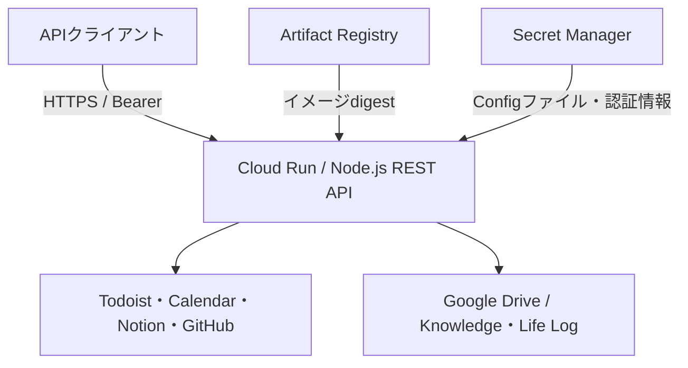

# AI Foundation — Cloud Run構成・設定・デプロイ運用

更新日: 2026-11-15（JST）

今回実際に配置した構成と運用記録。通常更新には[自動化コマンド](cloud-run.md)を利用できる。以下のPowerShellは手動運用の参考。

## 1. 現在地

- 実装: PR #41をmainへマージ済み。
- Cloud Runへの初回配置、本番Vaultへの切り替え、ロールバック、本番復帰まで確認済み。
- HTTPS APIとして利用できる。ChatGPT／Muse固有の接続設定は別工程。
- ソース・既存手順の正本はGitHub。本文書は今回の実行記録とPowerShell利用者向けの整理。
- 公開リポジトリへ転記できるよう、Project ID、公開URL、Vault ID、Credentialの実値は含めない。

| 記録 | 値 |
|---|---|
| イメージタグ／commit短縮値 | `b860e71` |
| 配置digest | `sha256:141c4ad02e042dc36d11ee34737da7b5600fa8c998edf9791ef00df720da8b76` |
| 初回revision | `ai-foundation-00001-zcm` |
| 現在の本番revision | `ai-foundation-00003-rhw` |
| 現在のトラフィック | 本番revisionへ100%、latest追従 |
| Config version | 1＝検証用Vault、2＝本番Vault |
| その他のSecret version | 7 Secretとも1 |

参照: [Issue #39・配置結果](https://github.com/thanatos27/ai-foundation/issues/39#issuecomment-6883946651)、[Plan PR #40](https://github.com/thanatos27/ai-foundation/pull/40)、[実装PR #41](https://github.com/thanatos27/ai-foundation/pull/41)。

## 2. 構成



| 要素 | 役割 |
|---|---|
| Cloud Run | APIの実行、HTTPS終端、スケーリング |
| Artifact Registry | ビルド済みコンテナの保存。Cloud Runと同じ東京リージョン |
| Secret Manager | 個人用Configと外部サービスのCredentialを実行時に注入 |
| ローカルPC | ビルド・テスト・手動デプロイを行う。API稼働中はPC停止可 |
| 各SoT | 業務データの正本。Cloud Runのローカルディスクに永続データを置かない |

ダッシュボードは、将来このAPIを利用する画面として追加できる。画面用のログインは別途設計し、共通APIキーを配信するJavaScriptへ埋め込まない。

## 3. Cloud Run設定

| 項目 | 設定 |
|---|---|
| サービス | `ai-foundation` |
| リージョン | `asia-northeast1` |
| 実行環境 | Linux amd64、Node.js 24、非rootユーザー |
| 起動 | `node dist/serve-http.js --no-env-file --host 0.0.0.0` |
| 待受 | `0.0.0.0:$PORT`。通常8080、Cloud RunがPORTを注入 |
| CPU／メモリ | 1 vCPU／512MiB |
| 課金 | request-based、CPU throttling有効 |
| 最小／最大インスタンス | 0／1 |
| 同時実行 | 80 |
| タイムアウト | 300秒 |
| 起動時CPU boost | 有効 |
| 到達性 | ingress all、Google IAMのInvoker認証を要求しない |
| アプリ認証 | 全ルートで共有Bearer APIキーを要求 |
| 起動確認 | TCP startup probe。認証なしの公開ヘルスチェックは追加しない |

PORTの優先順位は `--port > AI_FOUNDATION_HTTP_PORT > PORT > 8787`。Cloud Runではアプリ固有のHost／Port変数を設定しない。

最大1は分散排他の保証ではない。更新時などに複数インスタンスが動く場合がある。同じVaultへ書くローカルMCP／HTTPを並行起動せず、デプロイ中はクライアントの書き込みを止める。Driveの同名作成ロックはプロセス内のみ。追記の条件付き更新は既存仕様を維持する。

## 4. Config・Secret

| Secret名 | 注入先 | 現在version |
|---|---|---:|
| `ai-foundation-config` | `/etc/ai-foundation/config.yaml` | 2 |
| `ai-foundation-api-key` | `AI_FOUNDATION_API_KEY` | 1 |
| `ai-foundation-todoist-api-token` | `TODOIST_API_TOKEN` | 1 |
| `ai-foundation-google-oauth-client-id` | `GOOGLE_OAUTH_CLIENT_ID` | 1 |
| `ai-foundation-google-oauth-client-secret` | `GOOGLE_OAUTH_CLIENT_SECRET` | 1 |
| `ai-foundation-google-oauth-refresh-token` | `GOOGLE_OAUTH_REFRESH_TOKEN` | 1 |
| `ai-foundation-notion-api-token` | `NOTION_API_TOKEN` | 1 |
| `ai-foundation-github-token` | `GITHUB_TOKEN` | 1 |

- `AI_FOUNDATION_CONFIG=/etc/ai-foundation/config.yaml`を通常の環境変数として設定する。
- Secretの参照はversion番号で固定する。`latest`を使わない。
- 専用サービスアカウント `ai-foundation-run` に、8 Secretそれぞれの `roles/secretmanager.secretAccessor` を付与する。
- 外部Google APIは既存のOAuthクライアント・Refresh Tokenで接続する。実行用サービスアカウントにCalendar／Driveの権限は追加しない。
- ConfigとCredentialはイメージ・ビルドコンテキストに含めない。

ローカルで使うファイル:

| ファイル | 内容 | 管理 |
|---|---|---|
| `config.cloud.yaml` | クラウド用Config。Knowledgeは`storage: google_drive`、`vault_folder_id`を指定。`vault_path`は不要 | Git対象外 |
| `.env.cloud` | クラウド専用APIキー＋6つのProvider Credential | Git対象外 |
| `.env` | 従来のローカル認証情報 | Git対象外 |

Life Logは既存のObsidian設定を利用し、Vault内のKnowledge／Life Logディレクトリを指定する。Configファイルは重ね合わせず1ファイルで完結させる。

`.env.cloud`はNodeの`util.parseEnv`でファイルを直接解析する。`node --env-file`経由で`process.env`を参照するとシェルに残った古い値が優先されるため、Secret登録には使わない。

## 5. 初回準備（実施済み）

1. Google Cloud CLIとDocker Desktopを導入。Node.js 24以降、npmを用意する。
2. `gcloud init`でログインし、既存Calendar／Drive OAuthのプロジェクトを選択する。
3. 課金アカウントを確認し、予算通知を設定する。月1,000円、50%／90%／100%通知は今回の案内値。予算通知は課金停止の上限ではない。
4. リージョンを設定し、必要APIを有効化する。

```powershell
gcloud config set run/region asia-northeast1
gcloud services enable run.googleapis.com artifactregistry.googleapis.com secretmanager.googleapis.com
```

5. 保存先とDocker認証を設定する（新規作成は初回のみ）。

```powershell
gcloud artifacts repositories create ai-foundation --repository-format=docker --location=asia-northeast1
gcloud auth configure-docker asia-northeast1-docker.pkg.dev
gcloud iam service-accounts create ai-foundation-run --display-name="AI Foundation (Cloud Run)"
```

6. 前節の8 Secretを東京へのuser-managed replicationで作り、専用サービスアカウントにSecret単位の読み取り権限を付ける。
7. 検証用Configと認証情報を登録する。実値を引数や画面に出さず、ファイル／標準入力から渡す。
8. Google OAuth同意画面の公開状態を確認する。テスト状態の認可では、Calendar／DriveのRefresh Tokenが短期間で失効し得る。再認可は既存の`npm run auth:google -- --drive`を使う。

Compute Engine APIのゾーン取得エラーは今回の構成に不要なため、Compute Engine APIを追加有効化していない。

## 6. 通常デプロイ（現状のPowerShell手順）

各ネイティブコマンドが失敗したら停止する。PowerShellでは`$ErrorActionPreference`だけでは外部コマンドの失敗を一律に検出できないため、`$LASTEXITCODE`を確認する。変更のない作業ツリー・レビュー済みcommitを使う。

### ビルド・テスト・push

```powershell
$projectId = (gcloud config get-value project).Trim()
$image = "asia-northeast1-docker.pkg.dev/$projectId/ai-foundation/ai-foundation"
$tag = (git rev-parse --short HEAD).Trim()

npm ci
if ($LASTEXITCODE -ne 0) { throw "npm ci failed" }
npm run typecheck
if ($LASTEXITCODE -ne 0) { throw "typecheck failed" }
npm run build
if ($LASTEXITCODE -ne 0) { throw "build failed" }
npm test
if ($LASTEXITCODE -ne 0) { throw "test failed" }

docker build --pull --platform linux/amd64 -t ai-foundation:candidate .
if ($LASTEXITCODE -ne 0) { throw "docker build failed" }
$candidateId = (docker image inspect -f '{{.Id}}' ai-foundation:candidate).Trim()
if ($LASTEXITCODE -ne 0) { throw "image inspect failed" }
$env:AI_FOUNDATION_CONTAINER_IMAGE = $candidateId
npm run test:container
if ($LASTEXITCODE -ne 0) { throw "container test failed" }

docker tag $candidateId "${image}:$tag"
if ($LASTEXITCODE -ne 0) { throw "docker tag failed" }
docker push "${image}:$tag"
if ($LASTEXITCODE -ne 0) { throw "docker push failed" }
```

pushが返す`sha256:...`を配置対象にする。テスト後にイメージを再ビルドしない。`--pull`でベースイメージの更新を取得する。イメージIDとレジストリdigestは用途が異なるため混同しない。

### 配置

書き込みを止め、直前の要求の完了を待つ。現在の本番構成を再配置する例ではConfig 2・他のSecret 1を指定する。将来のSecret更新時は必要な番号を変更する。

```powershell
$digest = "sha256:<pushで確認したdigest>"
$runServiceAccount = "ai-foundation-run@${projectId}.iam.gserviceaccount.com"
$beforeRevision = (gcloud run services describe ai-foundation --region=asia-northeast1 --format="value(status.latestReadyRevisionName)").Trim()

$secretBindings = @(
  "/etc/ai-foundation/config.yaml=ai-foundation-config:2"
  "AI_FOUNDATION_API_KEY=ai-foundation-api-key:1"
  "TODOIST_API_TOKEN=ai-foundation-todoist-api-token:1"
  "GOOGLE_OAUTH_CLIENT_ID=ai-foundation-google-oauth-client-id:1"
  "GOOGLE_OAUTH_CLIENT_SECRET=ai-foundation-google-oauth-client-secret:1"
  "GOOGLE_OAUTH_REFRESH_TOKEN=ai-foundation-google-oauth-refresh-token:1"
  "NOTION_API_TOKEN=ai-foundation-notion-api-token:1"
  "GITHUB_TOKEN=ai-foundation-github-token:1"
) -join ","

$deployArgs = @(
  "run", "deploy", "ai-foundation"
  "--project=$projectId", "--region=asia-northeast1"
  "--image=${image}@$digest", "--service-account=$runServiceAccount"
  "--cpu-throttling", "--cpu=1", "--memory=512Mi", "--cpu-boost"
  "--min-instances=0", "--max-instances=1", "--concurrency=80", "--timeout=300"
  "--allow-unauthenticated", "--ingress=all"
  "--set-env-vars=AI_FOUNDATION_CONFIG=/etc/ai-foundation/config.yaml"
  "--set-secrets=$secretBindings"
)
gcloud @deployArgs
if ($LASTEXITCODE -ne 0) { throw "deploy failed" }
```

`--set-env-vars`／`--set-secrets`は既存設定を置換する。手動追加した変数を維持する場合は事前に整理する。今回の再作成検証用`AI_FOUNDATION_DEPLOY_CHECK`はアプリに必要な設定ではない。

過去にトラフィックを特定revisionへ戻した場合は、新revisionの起動確認後に次で最新へ切り替える。

```powershell
gcloud run services update-traffic ai-foundation --region=asia-northeast1 --to-latest
```

`latestReadyRevisionName`は最新の起動済みrevisionであり、常にトラフィック先とは限らない。ロールバック先を記録する際は`status.traffic`と照合する。自動化では実際に100%を受けるrevisionを記録する設計とする。

## 7. 配置後確認・更新・復旧

通常更新では、以下の読み取り確認後に書き込みを再開する。検証用記事を作るテストは、通常デプロイとは分ける。

| 確認 | 期待値 |
|---|---|
| キーなし・不正キーの`/openapi.json` | 401・401 |
| 正しいキーの`/openapi.json` | 200 |
| Tasks・Schedules・Collection・Projects・Areas | 200。Schedulesは期間必須、Collectionは`/v1/collection-items` |
| Cloud Run traffic | 意図したrevisionへ100% |
| ログ | 予期しないエラー、認証情報の実値がない。認証拒否テストの401 WARNINGは正常 |

確認用URLは `gcloud run services describe ai-foundation --region=asia-northeast1 --format="value(status.url)"` で取得できる。

### Configだけの更新

```powershell
gcloud secrets versions add ai-foundation-config --data-file=config.cloud.yaml
# 出力されたversion番号で次を実行する。3は例。
gcloud run services update ai-foundation --region=asia-northeast1 --update-secrets="/etc/ai-foundation/config.yaml=ai-foundation-config:3"
```

Secretへ新versionを登録するだけでは既存revisionは変わらない。Cloud Runの参照version更新で新revisionを作り、動作を確認する。Credential更新も同じ流れで行う。

### ロールバック

```powershell
gcloud run revisions list --service=ai-foundation --region=asia-northeast1
$rollbackRevision = "<戻したいrevision>"
gcloud run services update-traffic ai-foundation --region=asia-northeast1 "--to-revisions=${rollbackRevision}=100"
gcloud run services describe ai-foundation --region=asia-northeast1 --format="yaml(status.traffic)"
```

戻るのはイメージ・Config・Secret参照の組。Todoist／Calendar／Notion／Driveへの書き込みは戻らない。参照されるSecret versionとイメージは保持する。ロールバック後のsmokeには、そのrevisionのAPIキーを使う必要がある。

## 8. 実施済み検証と残件

| 検証 | 結果 |
|---|---|
| HTTPS・認証 | 401／401／200を確認 |
| 全SoTの読み取り | Todoist・Calendar・Collection・Projects・Areasで200 |
| Drive 7操作 | Knowledge 4操作・Life Log 3操作が成功。元本文・追記内容も検査 |
| 再作成 | 新revisionから記事2件の元本文・追記内容を取得 |
| 本番切り替え | Config 2で本番Knowledgeの内容を確認 |
| 復旧 | Config 1のrevisionへ戻して検証用記事を取得後、本番revisionへ100%復帰 |
| ログ | 利用者確認済み。画像の警告2件は認証テストの401 |
| 自動整理 | dry-runで設定確認後、有効化済み |
| cold start | 専用計測は未実施。配置処理の時間とAPIの起動待ち時間は区別する |

検証用Vaultに残した`cloud-run-check-1794687418583`のKnowledgeと同日のLife Logは、Drive上でゴミ箱へ移す。片付け完了はまだ確認していない。配置後1週間・1か月に実請求を確認する。

## 9. 費用・保持方針

2026-11-15に公式料金表を照合。以下は利用想定であり、請求額の保証ではない。

| 項目 | 前提・目安 |
|---|---|
| Cloud Run | 月3,000回・平均2秒の想定。無料枠は月180,000 vCPU秒・360,000 GiB秒・200万要求。起動・CPU boost等も加算 |
| Artifact Registry | 現在約88.975MB。無料枠0.5GiB。同一リージョンへのpull転送は無料 |
| Secret Manager | Config 2版＋7 Secret＝9 active versions。無料6版が他用途で未消費なら保管料は月約$0.18。取得は月10,000回まで無料、超過10,000回あたり$0.03 |
| Cloud Logging | 通常ログの月50GiB／Projectまで無料。保持期間延長等は別料金 |
| Cloud Build | 不使用 |
| 通信 | 応答や外部サービスへの送信量・宛先に応じて追加費用 |

イメージ整理は最新3世代を保持し、それ以外で30日を過ぎたものを削除する。30日以内の古い版は3世代を超えて残り得るため、最大3世代に制限する設定ではない。現在稼働中・必要な復旧先のdigestが保持対象か、今後の配置でも確認する。Secretは現行と必要な復旧先が参照するversionを保持する。Disabledも保管課金の対象。

料金表: [Cloud Run](https://cloud.google.com/run/pricing)、[Artifact Registry](https://cloud.google.com/artifact-registry/pricing)、[Secret Manager](https://cloud.google.com/secret-manager/pricing)、[Logging](https://cloud.google.com/products/observability/pricing)。無料枠の多くは請求アカウント単位で共有される。円建ての請求額は適用SKU価格等に従う。

